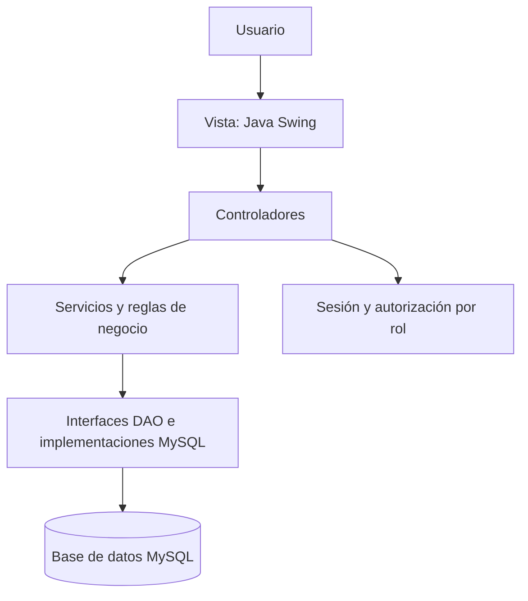

🏋️ GymFit — Sistema de registro de pagos


> [!NOTE]
> Proyecto académico del curso **Integrador I: Sistemas - Software**. Implementa el caso de uso **«Registrar pago»** de un gimnasio, utilizando una arquitectura Java organizada en capas y persistencia mediante MySQL.
📑 Tabla de contenidos
Descripción general
Funcionalidades y reglas de negocio
Tecnologías utilizadas
Arquitectura del proyecto
Requisitos previos
Instalación y configuración
Datos de acceso para pruebas
Pruebas y verificación
Seguridad y cambio de contraseña del SQL
Alcance del proyecto
---
📌 Descripción general
GymFit es una aplicación de escritorio desarrollada en Java 24 con Java Swing. Permite que usuarios autorizados registren pagos de cuotas de los socios de un gimnasio, validando el monto y el estado de cada cuota antes de guardar la operación en una base de datos MySQL.
El proyecto busca practicar la separación de responsabilidades entre la interfaz gráfica, los controladores, las reglas de negocio y el acceso a datos.
✨ Funcionalidades y reglas de negocio
Inicio de sesión: autenticación de usuarios registrados, mediante contraseñas verificadas con BCrypt.
Autorización por roles: distinción entre `ADMIN`, `ASESOR` y `ENTRENADOR`.
Registro de pagos: ingreso del identificador de cuota, monto y medio de pago.
Persistencia: actualización de la cuota en MySQL mediante JDBC y `PreparedStatement`.
Mensajes de validación: el sistema informa cuando un pago no puede registrarse.
Regla	Validación	Resultado
R1	La cuota debe estar en estado `PENDIENTE`.	Evita registrar pagos duplicados o sobre cuotas no pendientes.
R2	El importe ingresado debe coincidir con el monto de la cuota.	Rechaza montos incorrectos.
R3	Solo los roles `ADMIN` y `ASESOR` pueden registrar pagos.	Impide que un usuario `ENTRENADOR` registre pagos.
Medios de pago disponibles: `EFECTIVO`, `TARJETA` y `TRANSFERENCIA`.
🛠️ Tecnologías utilizadas
Tecnología	Versión / uso
Java JDK	24 — lenguaje y entorno de ejecución.
Apache NetBeans	IDE utilizado para desarrollar y ejecutar el proyecto.
Apache Maven	Compilación y administración de dependencias mediante `pom.xml`.
MySQL Server	8.x — base de datos relacional.
MySQL Workbench	Administración y ejecución del script SQL.
MySQL Connector/J	8.4.0 — conexión JDBC entre Java y MySQL.
Java Swing	Interfaz gráfica de escritorio.
BCrypt (jBCrypt)	0.4 — verificación de contraseñas mediante hashes.
JUnit Jupiter	5.10.2 — biblioteca declarada para pruebas unitarias.
Maven Surefire	3.2.5 — ejecución de pruebas Maven.
🧱 Arquitectura del proyecto
El programa separa la interfaz de usuario de las reglas del negocio y del acceso a datos.

Paquetes principales:
```text
src/main/java/pe/gymfit/
├── Main.java               # Punto de entrada
├── config/                 # Conexión a MySQL
├── controlador/            # LoginController, CuotaController
├── dao/                    # Contratos DAO y excepciones
│   └── mysql/              # Implementaciones JDBC
├── modelo/                 # Cuota, Usuario y enumeraciones
├── seguridad/              # Roles, sesión, autenticación y BCrypt
├── servicio/               # Reglas de negocio y pagos
└── vista/                  # Ventanas de inicio de sesión y pago

sql/
└── gymfit.sql              # Estructura y datos de prueba de MySQL
```
💻 Requisitos previos
Antes de ejecutar GymFit, asegúrate de disponer de:
JDK 24 instalado y configurado en NetBeans.
Apache NetBeans compatible con JDK 24.
MySQL Server 8.x instalado y en ejecución.
MySQL Workbench o un cliente SQL equivalente para importar el script.
Maven, disponible desde NetBeans o instalado para usarlo en terminal.
Acceso a internet durante la primera compilación para descargar las dependencias de Maven, si todavía no están almacenadas localmente.
> [!IMPORTANT]
> La aplicación requiere conectarse a un servidor MySQL. Abrir Workbench no es suficiente si el servicio MySQL está detenido.
🚀 Instalación y configuración
1. Obtener el proyecto
Clona el repositorio con Git, o descárgalo como ZIP desde GitHub y ábrelo en NetBeans:
```bash
git clone https://github.com/TU_USUARIO/gymfit.git
```
> Sustituye `TU_USUARIO` por el nombre de la cuenta que publique el repositorio. Si está configurado como privado, necesitas autorización para acceder.
2. Crear la base de datos
Abre MySQL Workbench con una cuenta administradora (por ejemplo, `root`), selecciona File > Open SQL Script..., abre `sql/gymfit.sql` y ejecútalo.
El script crea la base de datos `gymfit`, sus datos iniciales y un usuario de aplicación con permisos limitados.
Tablas incluidas:
Tabla	Propósito
`plan`	Planes de gimnasio.
`socio`	Datos de los socios.
`membresia`	Relación entre socios y planes.
`cuota`	Cuotas, estados y pagos.
`entrenador`	Entrenadores del gimnasio.
`rutina`	Rutinas asignadas a socios.
`usuario`	Usuarios del sistema, roles y hashes de contraseña.
> [!CAUTION]
> El script incluye `DROP DATABASE IF EXISTS gymfit;`. **Ejecutarlo nuevamente elimina la base de datos anterior y todos sus registros**, y después la reconstruye. Úsalo solamente en un entorno de pruebas o después de respaldar la información.
3. Configurar la contraseña de MySQL
Antes de ejecutar el SQL descargado, localiza la instrucción que crea la cuenta de aplicación:
```sql
CREATE USER 'app_gymfit'@'localhost'
IDENTIFIED BY 'CAMBIAR_CLAVE_AQUI';
```
Reemplaza `CAMBIAR_CLAVE_AQUI` por una contraseña propia en tu copia local del script, antes de ejecutarlo. Si no lo reemplazas, MySQL tomará literalmente ese texto como contraseña.
El usuario `app_gymfit` se crea para que la aplicación acceda a la base sin utilizar la cuenta administradora `root`. Sus privilegios previstos son `SELECT`, `INSERT` y `UPDATE` sobre `gymfit`.
4. Crear el archivo db.properties
Dentro de `src/main/resources/`, crea un archivo llamado `db.properties` con estos datos:
```properties
db.url=jdbc:mysql://localhost:3306/gymfit?useSSL=false&serverTimezone=America/Lima
db.user=app_gymfit
db.password=TU_CONTRASENA_LOCAL
```
Cambia `TU_CONTRASENA_LOCAL` por la misma contraseña que configuraste para `app_gymfit` en MySQL. Si tu servidor utiliza otro puerto, modifica `3306` por el puerto correspondiente.
> [!WARNING]
> **No publiques `db.properties`.** Contiene las credenciales locales de conexión y se excluye del repositorio mediante `.gitignore`. La opción `useSSL=false` está pensada para esta práctica local; no debe copiarse sin revisión a un despliegue remoto.
5. Compilar y ejecutar
Abre Apache NetBeans.
Selecciona File > Open Project y abre la carpeta del proyecto Maven.
Comprueba que el proyecto está configurado para usar JDK 24.
Selecciona Clean and Build para compilar.
Ejecuta el proyecto con F6; su clase principal es `pe.gymfit.Main`.
Inicia sesión con una cuenta de prueba y realiza las validaciones del registro de pagos.
Desde una terminal que tenga configurados Maven y JDK 24 también puedes compilar con:
```bash
mvn clean package
```
🔑 Datos de acceso para pruebas
A. Usuarios que inician sesión en GymFit
Los siguientes usuarios de demostración están incluidos en el script SQL del laboratorio:
Usuario	Contraseña de prueba	Rol	¿Puede registrar pagos?
`carla`	`Carla2026*`	`ASESOR`	✅
`admin`	`Admin2026*`	`ADMIN`	✅
`pedro`	`Pedro2026*`	`ENTRENADOR`	❌
> Estas credenciales son **exclusivamente para desarrollo y pruebas**. No deben reutilizarse en un sistema real. En la tabla `usuario`, las contraseñas se almacenan como hashes BCrypt, no como texto plano.
B. Cuenta de acceso a MySQL
Dato	Configuración
Servidor	`localhost`
Puerto predeterminado	`3306`
Base de datos	`gymfit`
Usuario de la aplicación	`app_gymfit`
Contraseña	La configurada localmente por quien instala el proyecto.
Diferencia importante: `carla`, `admin` y `pedro` se utilizan en la ventana de inicio de sesión; `app_gymfit` se utiliza internamente para conectarse a MySQL.
🧪 Pruebas y verificación
Caso de pago válido
Usa la cuenta `carla` e introduce:
Campo	Valor
Número de cuota	`1`
Monto	`129.00`
Medio de pago	`TARJETA`
Si la cuota 1 se encuentra pendiente, el sistema debe registrar el pago. Compruébalo en Workbench:
```sql
SELECT id_cuota, monto, estado, medio_pago, fecha_pago
FROM gymfit.cuota
WHERE id_cuota = 1;
```
El estado esperado después del pago es `PAGADA`, con el medio `TARJETA` y la fecha correspondiente.
Casos de validación
R1: intentar pagar dos veces la misma cuota debe ser rechazado.
R2: introducir un monto incorrecto debe ser rechazado.
R3: iniciar sesión con `pedro` e intentar pagar debe mostrar un mensaje de falta de permisos.
El proyecto declara JUnit 5 y Maven Surefire como herramientas para realizar pruebas unitarias. Cuando se hayan creado las clases de prueba en `src/test/java`, se pueden ejecutar con:
```bash
mvn test
```
> La presencia de dependencias JUnit en `pom.xml` no implica que ya existan pruebas implementadas o ejecutadas.
🔐 Seguridad y cambio de contraseña del SQL
Por seguridad, el script de laboratorio usaba una contraseña fija de ejemplo al crear el usuario `app_gymfit`. Para publicar el proyecto en GitHub, se recomienda sustituir esa contraseña en `sql/gymfit.sql` por el marcador `CAMBIAR_CLAVE_AQUI`.
Esta modificación cumple una función documental:
Evita publicar como configuración recomendada la misma contraseña fija del laboratorio.
Indica que cada persona debe elegir su propia contraseña al instalar el proyecto.
No modifica automáticamente la contraseña de un usuario MySQL que ya exista.
No obliga a cambiar el archivo `db.properties` de una instalación local que ya esté funcionando.
No requiere volver a ejecutar el script para efectuar únicamente este cambio en el archivo del repositorio.
El archivo `.gitignore` excluye:
```gitignore
/target/
/src/main/resources/db.properties
/nbproject/private/
*.log
.DS_Store
```
> [!IMPORTANT]
> `.gitignore` no elimina archivos que ya fueron incorporados a Git. Además, **no excluye `sql/gymfit.sql`**. Antes de crear un commit, revisa que el SQL publicado use una contraseña de ejemplo y que no se estén subiendo credenciales reales.
📎 Alcance del proyecto
Esta implementación se enfoca en el caso de uso «Registrar pago» y en la aplicación de arquitectura por capas, acceso seguro a datos y validaciones de negocio. Aunque la base de datos incluye tablas de planes, socios, entrenadores y rutinas, el proyecto no implementa necesariamente interfaces completas de mantenimiento para todas esas entidades.
---
GymFit · Proyecto académico desarrollado con Java 24, Swing, Maven y MySQL.
